<p align="center">
  
</p>

<p align="center">
  <strong>A full-stack financial workspace for personal ledgers, monthly category budgets, collaborative group expense splits, and settlement cycles.</strong>
</p>

<p align="center">
  <a href="https://tallynest-plum.vercel.app"><strong>🌐 Launch Live Demo</strong></a> •
  <a href="docs/LOCAL_SETUP.md">Local Setup</a> •
  <a href="docs/ARCHITECTURE.md">Architecture</a> •
  <a href="docs/SECURITY_AND_VERIFICATION.md">Security &amp; Tests</a> •
  <a href="docs/GIF_CAPTURE_GUIDE.md">Media Guide</a>
</p>

TallyNest is a **full-stack financial web application** built with React 19, Vite, Tailwind CSS v4, Node.js 24 LTS, Express, and MongoDB. It replaces approximate floating-point balances with **exact integer minor currency units (paise)**, serializes group financial writes through a durable reservation coordinator, and organizes group finances into **isolated settlement cycles** that verify zero net debt before closure.

The demonstration URL is **[tallynest-plum.vercel.app](https://tallynest-plum.vercel.app)**. Use generated data only: the demonstration is not certified for real financial data. Hosted proxy attribution and backup/recovery verification remain incomplete.

---

## Application Preview & Screenshots

<p align="center">
  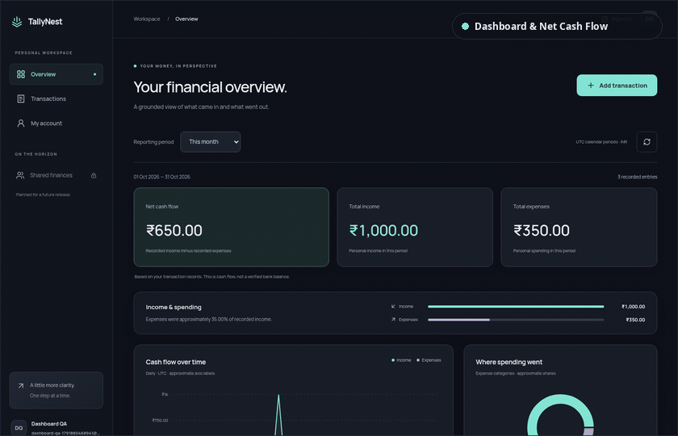
</p>

|                               Dashboard &amp; Net Cash Flow                                |                                  Personal Transaction Ledger                                  |
| :----------------------------------------------------------------------------------------: | :-------------------------------------------------------------------------------------------: |
|              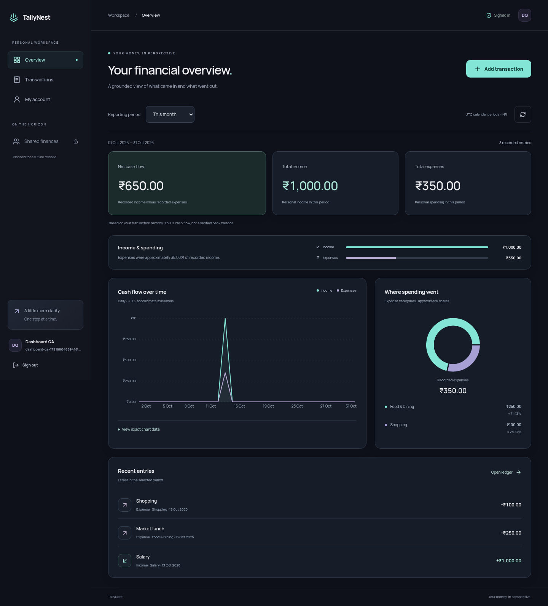              | 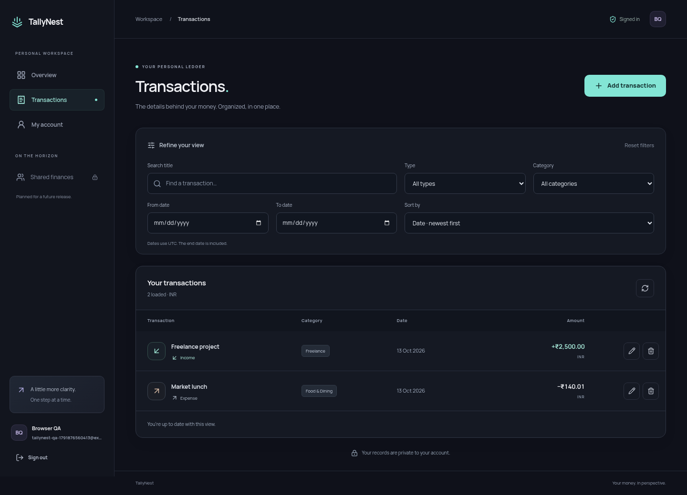 |
|                                **Monthly Category Budgets**                                |                               **Recurring Transaction Engine**                                |
|       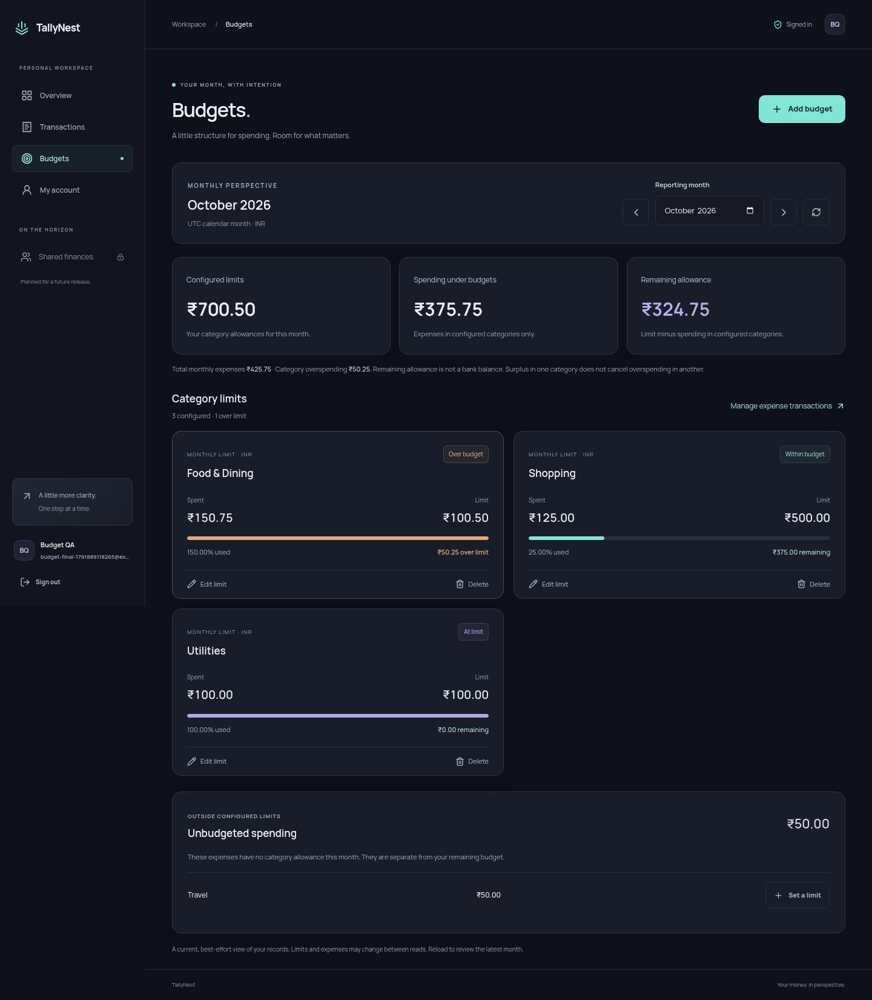        |      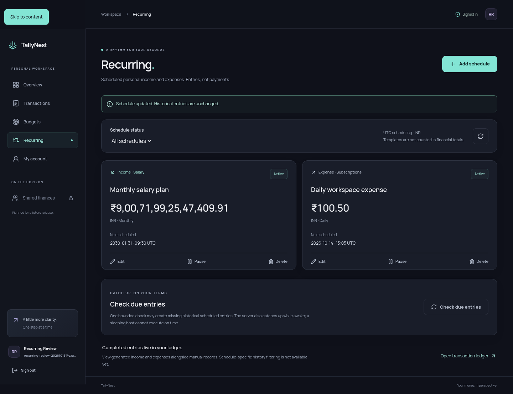      |
|                             **Collaborative Group Workspace**                              |                           **Shared Expenses &amp; Exact Splitting**                           |
|           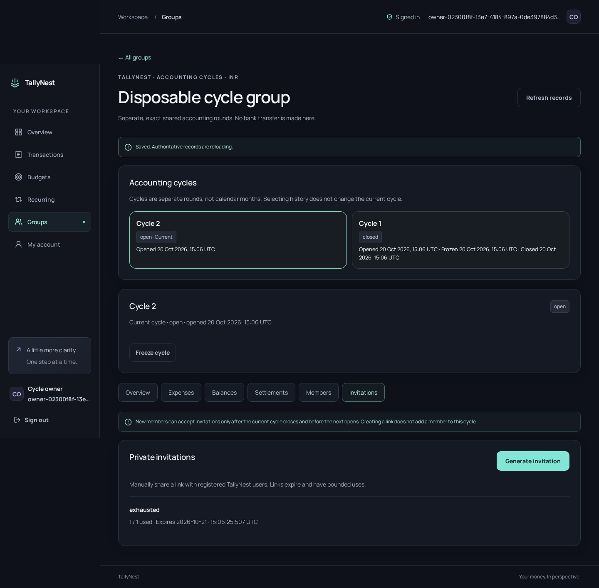           |   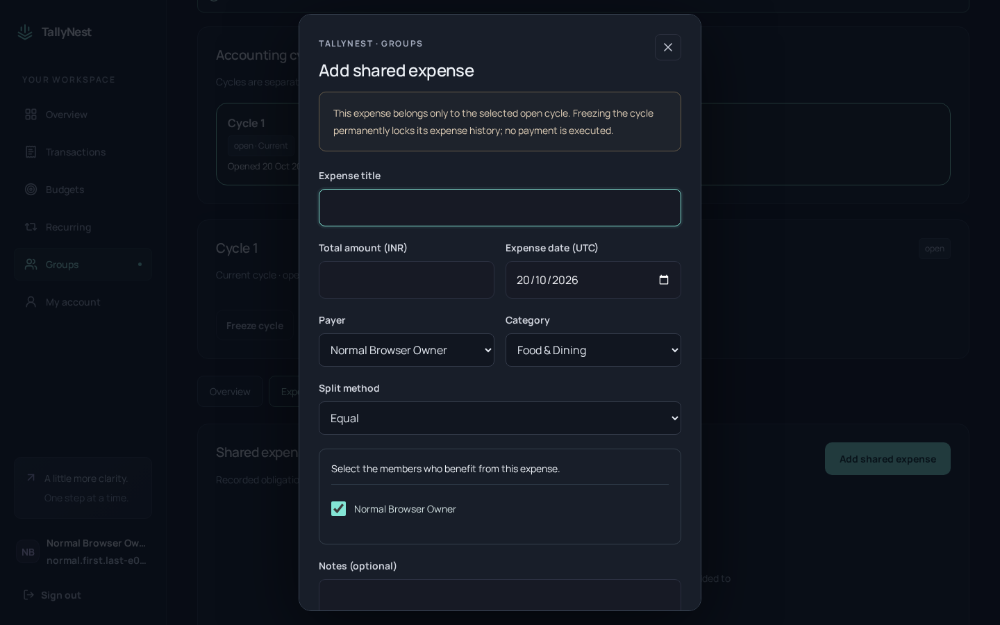    |
|                           **Balances &amp; Debt Reconciliation**                           |                                 **Financial Cycle Workspace**                                 |
|  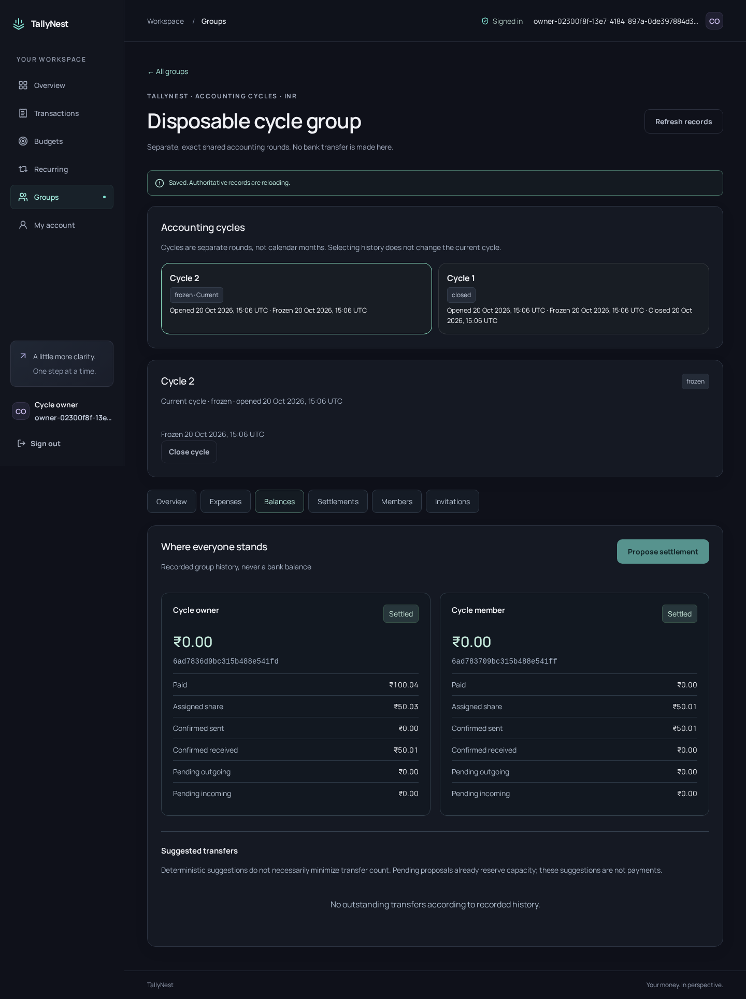  |    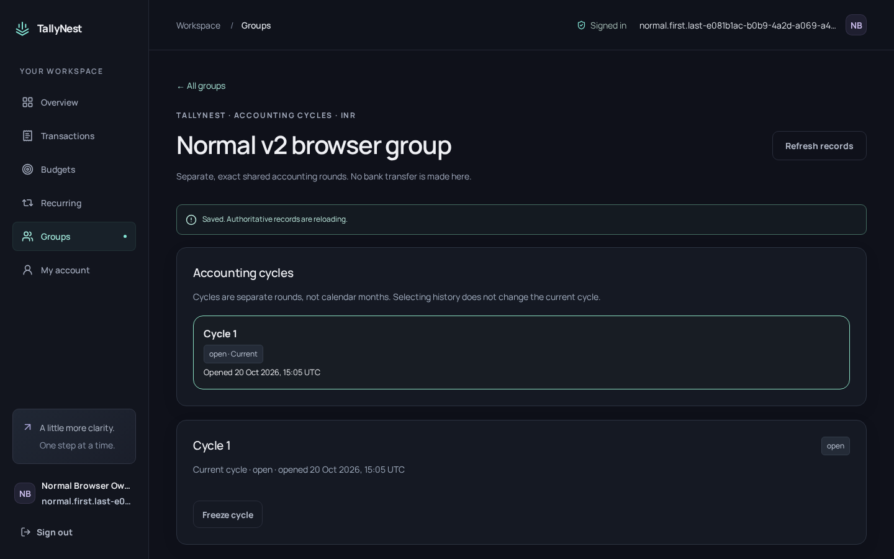    |
|                              **Responsive Mobile Experience**                              |                               **Authorized Financial Recovery**                               |
| 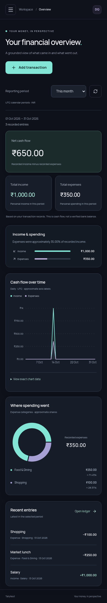 |   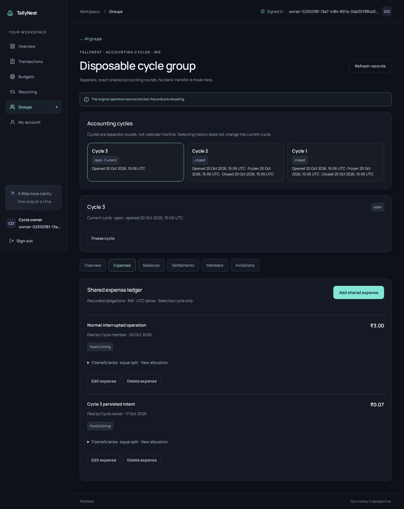   |

_Screenshots captured from the running React frontend and MongoDB-backed Express API. The preview montage uses these genuine application screens. The workflow recordings below capture real browser interactions with the API and a disposable test database; see the [GIF capture guide](docs/GIF_CAPTURE_GUIDE.md)._

---

## Key Features & Live Workflows

### Personal Transaction Ledger

Record income and expense entries stored strictly in integer minor currency units (paise). Filter across categories, types, and date ranges with cursor-paginated ledgers and refreshed server results.

<p align="center">
  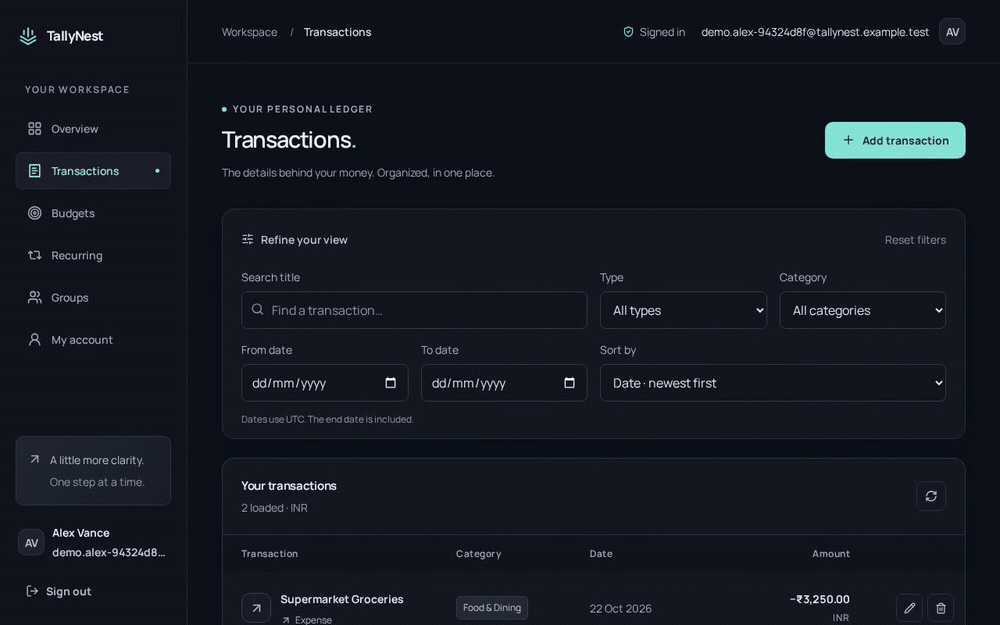
</p>

- **Minor Currency Math**: Eliminates IEEE 754 floating-point drift by storing all values as integer paise (100 paise = ₹1.00).
- **Client Version Guarding**: Enforces optimistic concurrency (`__v`) and ETag validation (`412 Precondition Failed` on stale edits).
- **Cursor Pagination**: Stable navigation across live transaction feeds using scoped continuation cursors.

---

### Monthly Category Budgets

Configure independent spending caps per expense category. Track real-time progress bars, percentage consumed, and threshold warnings calculated dynamically from persisted personal expenses.

<p align="center">
  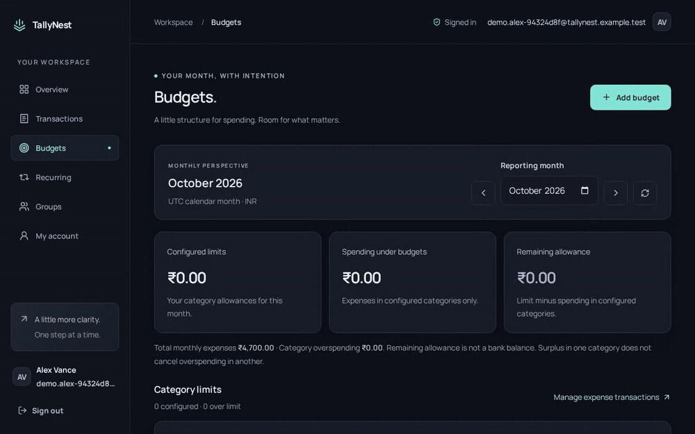
</p>

- **Multi-Category Limits**: Independent budgets for Dining, Utilities, Subscriptions, Housing, and Healthcare.
- **Dynamic Threshold Analytics**: Visual indicators highlight on-track spending, warnings (80%+), and exceeded thresholds.
- **Month Isolation**: Budgets remain scoped to their calendar month; future and past months remain untouched.

---

### Recurring Transaction Engine

Automate recurring expenses and income streams. Configure schedules by interval (daily, weekly, monthly, yearly) and monitor upcoming execution dates, statuses, and historical runs.

<p align="center">
  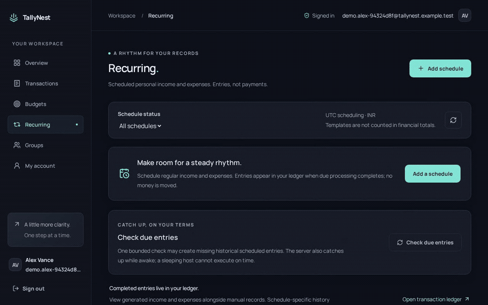
</p>

- **Idempotent Schedule Execution**: Prevents duplicate executions under concurrent engine ticks.
- **Active / Paused States**: Toggle schedules without deleting configurations or transaction history.
- **Calendar Boundary Projection**: Deterministic next-run calculations respecting calendar month lengths.

---

### Collaborative Groups & Financial Cycles

Organize shared living expenses, trips, or projects into collaborative groups with secure invitations, split engines, debt simplification, and settlement cycles.

<p align="center">
  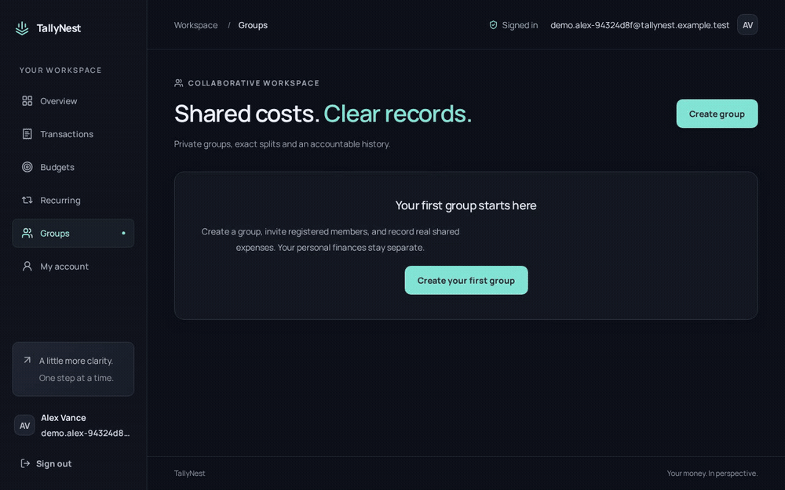
</p>

- **Exact Split Allocations**: Split expenses using **Equal**, **Exact**, or **Percentage** algorithms. Equal splits assign remainder paise in canonical user-ID order; percentage splits use largest remainders with user-ID tie-breaking. Shares sum exactly to the total.
- **Settlement Cycles**: Activity is scoped into explicit cycles (`open` → `frozen` → `closed`). Closing requires every member balance to be exactly ₹0.00 and no pending settlements.
- **Durable Write Coordinator**: Group writes reserve an `applying` phase slot in MongoDB before insertion. Interrupted writes fail closed (`FINANCIAL_BUSY`) and can be reconciled via authorized owner recovery.

---

## Tech Stack

| Layer           | Technologies                                                                                                                                   | Role in TallyNest                                                                     |
| --------------- | ---------------------------------------------------------------------------------------------------------------------------------------------- | ------------------------------------------------------------------------------------- |
| **Frontend**    | [React 19](https://react.dev/), [Vite 8](https://vite.dev/), [Tailwind CSS v4](https://tailwindcss.com/)                                       | Responsive client architecture and dark theme design tokens.                          |
| **UI & Charts** | [Manrope Variable](https://fontsource.org/), [Lucide](https://lucide.dev/), [Recharts 3](https://recharts.org/), [Motion](https://motion.dev/) | Typography, vector iconography, cash-flow analytics, and reduced-motion support.      |
| **Backend**     | [Node.js 24 LTS](https://nodejs.org/), [Express 5](https://expressjs.com/)                                                                     | Layered Controller → Service → Write Coordinator → Repository architecture.           |
| **Database**    | [MongoDB 8.0](https://www.mongodb.com/), [Mongoose 9](https://mongoosejs.com/)                                                                 | Strict JSON Schema collection validators, filtered unique indexes, atomic updates.    |
| **Validation**  | [Zod 4](https://zod.dev/)                                                                                                                      | Strict runtime input validation, environment parsing, and integer boundary checks.    |
| **Security**    | [JWT](https://jwt.io/), [bcryptjs](https://github.com/dcodeIO/bcrypt.js), [Helmet](https://helmetjs.github.io/)                                | HttpOnly host cookies, CSRF protection, per-user rate limits, protected edge ingress. |
| **Testing**     | Node `--test`, [Vitest](https://vitest.dev/), [Playwright](https://playwright.dev/)                                                            | Isolated unit/API tests, component tests, real MongoDB tests, and Chromium journeys.  |

---

## System Architecture

<p align="center">
  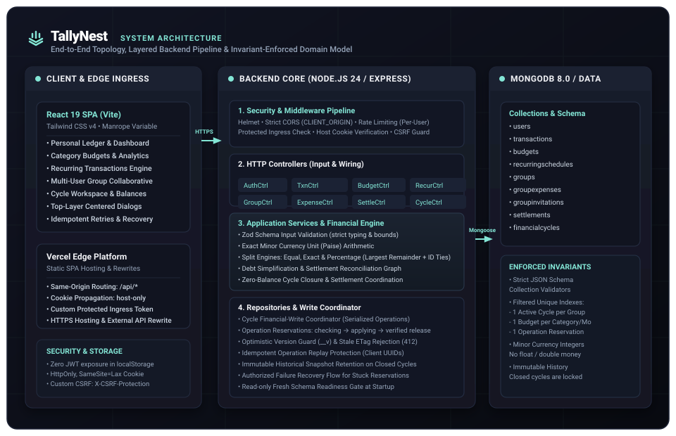
</p>

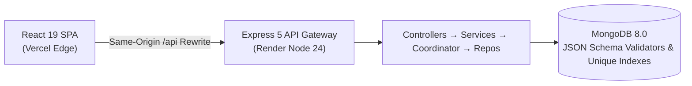

TallyNest enforces complete separation between request delivery, business logic, write serialization, and database persistence. Routes wire middleware and controllers; business logic resides strictly in application services.

For full state machine specifications, split remainder formulas, and failure recovery procedures, see [**System Architecture &amp; Financial Domain Design**](docs/ARCHITECTURE.md).

---

## Quick Local Setup

```bash
# 1. Clone repository and install dependencies
git clone https://github.com/TheQuantumPanda/TallyNest.git
cd TallyNest
npm run install:ci

# 2. Start local MongoDB container
docker compose up -d --wait mongodb

# 3. Initialize database schema on a dedicated test database
cd backend && npm run setup:env
FRESH_TEST_DB="$(node --input-type=module -e 'import { randomBytes } from "node:crypto"; console.log(`tallynest_fresh_v2_test_${Date.now()}_${randomBytes(6).toString("hex")}`)')"
npm run setup:cycles:fresh:test -- --database "$FRESH_TEST_DB"
export MONGO_URI="mongodb://127.0.0.1:27017/$FRESH_TEST_DB"
cd ..

# 4. Start backend in this shell (it retains MONGO_URI).
# Start frontend from the repository root in a second terminal.
npm run dev --prefix backend
npm run dev --prefix frontend
```

Open **[http://localhost:5173](http://localhost:5173)** in your browser. For Fish shell commands, environment variable tables, and teardown guides, see [**Local Setup Guide**](docs/LOCAL_SETUP.md).

---

## Testing & Verification

Verification keeps isolated application tests separate from disposable MongoDB and browser checks:

```bash
# Run isolated tests, lint, formatting, production build/canary, and audits
npm run verify:fast

# Run real MongoDB integration tests against local Docker container
npm run verify:mongo

# Run Playwright Chromium end-to-end browser journeys
npm run verify:browser

# Fast checks (including production build/canary) plus MongoDB; browser is separate
npm run verify
```

| Suite                      | Scope                      | Baseline                                                                                   |
| -------------------------- | -------------------------- | ------------------------------------------------------------------------------------------ |
| **Backend Unit &amp; API** | Node.js `--test` runner    | **338 passing tests**, 0 skips. Validates integer math, split algorithms, and cycle logic. |
| **Frontend Components**    | Vitest 5 + Testing Library | **267 passing tests** across 23 test suites. Covers forms, modals, and draft protection.   |
| **MongoDB Integration**    | 18 serial Node processes   | **274 passing test cases** exercising real schema validators and SIGKILL recovery drills.  |
| **Browser Journeys**       | Playwright Chromium        | Multi-user collaborative cycles, top-layer dialog assertions, and 200% zoom reflow.        |
| **Security Audits**        | ESLint + npm audit         | 0 warnings, 0 production vulnerabilities across both packages.                             |

For verification scope and the incomplete hosted proxy checks, see [**Security Architecture &amp; Verification Evidence**](docs/SECURITY_AND_VERIFICATION.md).

---

## Detailed Documentation

- [**Local Setup Guide (Bash &amp; Fish)**](docs/LOCAL_SETUP.md) — Step-by-step setup, database initialization, and environment variable references.
- [**System Architecture &amp; Financial Design**](docs/ARCHITECTURE.md) — Layered backend pipeline, paise math formulas, split algorithms, and cycle coordination.
- [**Security &amp; Verification Report**](docs/SECURITY_AND_VERIFICATION.md) — Cookie policies, CSRF defenses, test baselines, and operational trade-offs.
- [**Media &amp; GIF Capture Guide**](docs/GIF_CAPTURE_GUIDE.md) — Reproducibility instructions for animated headers, preview montages, and browser recordings.
- [**Deployment & Recovery Rehearsal Plan**](docs/deployment-rehearsal-plan.md) — Fresh provisioning, encrypted backup/restore procedures, and outstanding hosted acceptance gates.
- [**Settlement Cycle Cutover Runbook**](docs/runbooks/settlement-cycle-cutover.md) — Offline migration rehearsal and reconciliation runbook.

---

## Known Limitations

- **Free-Tier Cold Starts**: Deployed on Render's free tier, the backend spins down after inactivity. Wake-up commonly takes about a minute, without a response-time guarantee; see [Render Free limits](https://render.com/docs/free).
- **Recurring Scheduling**: The bounded worker runs on startup and roughly every 60 seconds while the process is active. It cannot execute while Render sleeps.
- **Recovery Status**: Hosted two-network proxy verification, independently retained backups, and hosted restore/reconciliation drills remain incomplete. See the [security and verification guide](docs/SECURITY_AND_VERIFICATION.md).
- **In-Memory Rate Limiting**: Rate limit buckets are stored in-process; restarting or scaling instances resets local counters.
- **Portfolio Context**: TallyNest is an engineering portfolio project with generated data; it does not connect to real banking networks or process legal tender payments.

---

## License

Released under the [MIT License](LICENSE). Copyright &copy; 2026 [TheQuantumPanda](https://github.com/TheQuantumPanda).
