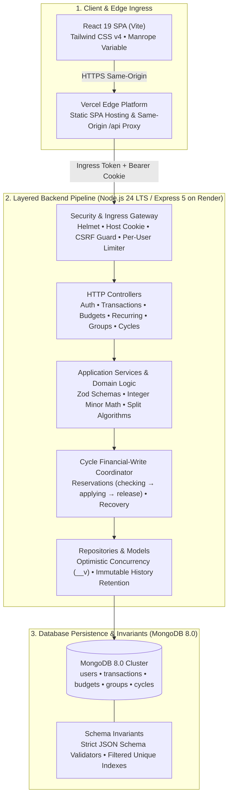

# TallyNest System Architecture & Financial Domain Design

This document details the architectural topology, layered backend design, financial invariants, and state machine specifications that govern TallyNest.

---

## 1. System Topology & Deployed Architecture

<p align="center">
  
</p>



---

## 2. Layered Backend Design

TallyNest adheres to a strict **Controller → Service → Write Coordinator → Repository → Model** architectural hierarchy:

1. **Routes & Middleware**: Wire endpoints, enforce authentication (`auth.middleware.js`), validate CSRF tokens (`csrf.middleware.js`), verify protected edge ingress (`proxy-ingress.middleware.js`), and apply per-user rate limits. Routes contain zero business logic.
2. **Controllers**: Parse and validate request parameters using Zod schemas, invoke corresponding application services, format output DTOs, and handle HTTP-specific status codes (e.g., `201 Created`, `404 Not Found`, `412 Precondition Failed`).
3. **Application Services**: Encapsulate core business rules, financial calculations, state transitions, and authorization checks.
4. **Cycle Write Coordinator**: Serializes concurrent financial modifications within groups, manages two-phase reservations, and ensures recovery safety.
5. **Repositories**: Build scoped MongoDB queries with tenant isolation (user ID or group ID), optimistic version filters (`__v`), and deterministic cursor pagination.
6. **Mongoose Models**: Declare strict schemas, enforce collection-level invariants, cast types, and prohibit arbitrary field injection (`strict: 'throw'`).

---

## 3. Financial Domain & Exact Minor Currency Mathematics

### Eliminating Floating-Point Drift

Stored transaction and expense amounts are positive safe integers in minor currency units (paise). Derived balances may be negative or zero. Split intermediates use BigInt and bounded conversions back to safe integers.
$$\text{INR minor unit: } 100 \text{ paise} = ₹1.00$$

Standard IEEE 754 binary floating-point representations cause precision loss in decimal arithmetic (e.g., `0.1 + 0.2 === 0.30000000000000004`). In financial ledgers, fractional rounding errors accumulate into severe balance discrepancies.

By restricting domain values to integer minor units:

- Money calculations use checked integer operations, with BigInt for split and reconciliation intermediates.
- The API accepts integer `amountMinor` values; forms parse decimal rupee strings with at most two fractional digits into minor units.
- Display transformations (`formatINR`, `decimalAmount`) are executed strictly for presentation.

### Split Allocation Invariants

When splitting an expense among $N$ group members, uneven amounts produce indivisible remainder paise:
$$\text{Example: } ₹100.01 \text{ (10,001 paise) split equally between 2 members}$$
$$\lfloor 10001 / 2 \rfloor = 5000 \text{ paise each, with a remainder of } 1 \text{ paise}$$

TallyNest guarantees:

1. **Zero Drift**: The sum of member shares must identically equal the expense total:
   $$\sum_{i=1}^{N} \text{share}_i = \text{totalAmountMinor}$$
2. **Deterministic Remainder Allocation**: Equal splits allocate remainder paise in canonical user-ID order. Percentage splits allocate by largest fractional remainder, breaking ties by canonical user ID. Exact splits must already total the amount.
3. **Method Support**:
   - **Equal Split**: Equal division with deterministic remainder distribution.
   - **Exact Split**: Explicit member allocations validated to match total.
   - **Percentage Split**: Basis points calculations with largest-remainder rounding.

---

## 4. Settlement Cycles & Lifecycle

Collaborative expenses are organized into isolated settlement cycles, governed by a strict state machine:

```
[Open] ──(Freeze Cycle)──> [Frozen] ──(Reconcile & Close)──> [Closed] ──(Open Next)──> [Cycle N+1]
```

### 1. Open State

- Group members record shared expenses and edit allocations.
- Balance calculations maintain live net debt positions.
- New member invitations can only be accepted at cycle boundaries.

### 2. Frozen State

- Freezing the cycle locks expense creation, edits, and deletions.
- Members propose settlements using deterministic debt simplification. The first settlement proposal also freezes an open cycle; rejection does not reopen expenses.
- The recipient member confirms settlement receipt through an authenticated mutual acknowledgment handshake.

### 3. Closed State (Zero-Balance Invariant)

- **Closure is prohibited if any member has a non-zero balance.**
- Only when net balances across all members equal **₹0.00** does the cycle permit closure.
- Application financial routes reject mutations to closed-cycle expense and settlement history. This does not protect against a privileged administrator directly tampering with the database.

### 4. Next Cycle Advance

- The group advances to Cycle $N+1$, snapshotting active members.
- Prior cycle records remain accessible as read-only historical archives.

---

## 5. Concurrency, Durability & Recovery

### Optimistic Concurrency Control

Versioned edits and lifecycle transitions require the client's current version identifier (`__v`) or a matching strong `If-Match` ETag. Stale writes are rejected immediately with `412 Precondition Failed`, prompting the client to review the latest state.

### Durable Write Reservations (`applying` phase)

Financial modifications execute through a two-phase write pattern:

1. The group reserves a fixed operation in `checking`, validates its immutable intent and preconditions, then promotes it to `applying` before applying the durable effect.
2. Ledger effects and lifecycle transition receipts use fixed IDs so retries can identify the original result.
3. The coordinator verifies completion and releases the reservation through conditional updates.

An interrupted applying operation blocks ordinary writes and affected balance reads with `FINANCIAL_BUSY`. Only the original actor or group owner may request reconciliation of the fixed operation. Corrupt or unproved outcomes remain blocked; recovery is not an arbitrary rollback or force-unlock.

See [financial operation recovery](SECURITY_AND_VERIFICATION.md#financial-operation-recovery) for user and operator steps, the [deployment/recovery plan](deployment-rehearsal-plan.md) for fresh-v2 backup procedures, and the [offline cutover runbook](runbooks/settlement-cycle-cutover.md) for legacy migration quarantine and rollback restrictions.
